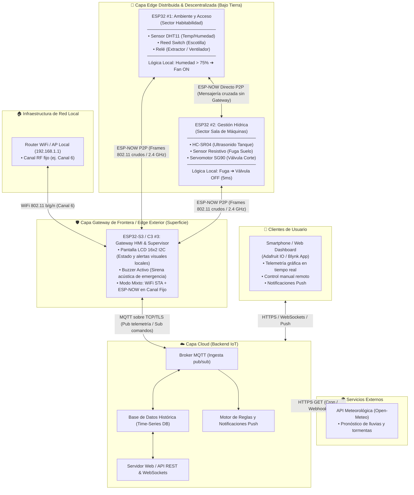

# BunkerOS: Arquitectura IoT Resiliente (Edge-to-Cloud)
> **Proxecto Novas Arquitecturas - Grupo 5 (Curso 26/27)**  
> Sistema de soporte vital y monitorización de misión crítica para búnker subterráneo con tolerancia a fallos, comunicación descentralizada P2P y sincronización con la nube.

---

## 1. Filosofía Arquitectónica: Edge Computing vs. Cloud

El principio rector del sistema es la **autonomía local con degradación elegante**:
> *La médula espinal (Edge) actúa sin esperar al cerebro (Cloud). Si tocas una sartén caliente, retiras la mano en milisegundos sin esperar que la orden viaje al cerebro y regrese. Tu cerebro se entera después.*

### Principios Fundamentales del Edge (ESP32):
1. **Cero Latencia ante Emergencias:**  
   Si se detecta agua en el suelo, el microcontrolador corta la válvula mediante servomotor en **< 5 milisegundos**. No se consulta a servidores remotos ni se espera respuesta de internet.
2. **Supervivencia sin Conectividad (Offline First):**  
   Si se corta la fibra óptica, falla el Punto de Acceso (AP) o cae un rayo, **el búnker sigue 100% operativo**. Los sensores y actuadores se comunican directamente por radiofrecuencia (ESP-NOW) a nivel de capa de enlace.
3. **Minimización de Superficie de Ataque y Aislamiento:**  
   Los nodos subterráneos (sensores y actuadores de soporte vital) no tienen IP, no tienen conexión a internet ni credenciales WiFi. Son inaccesibles e inhackeables desde el exterior.
4. **Filtrado y Procesamiento Local:**  
   El Edge filtra el ruido de los sensores físicos (promedios móviles e histéresis) y solo publica a la nube eventos agregados o cambios significativos de estado, ahorrando ancho de banda.

---

## 2. Diagrama Completo de Arquitectura

---

## 3. Desglose de Capas y Protocolos

### A. Capa Cloud (Nube)
* **Broker MQTT:** Punto central de enlace con el Gateway. Maneja tópicos como:
  * `bunker/telemetria/ambiente` (publica ESP32)
  * `bunker/telemetria/hidrico` (publica ESP32)
  * `bunker/alertas/critico` (publica ESP32 con QoS 1)
  * `bunker/comandos/valvula` (suscribe ESP32)
* **Base de Datos Histórica (Time-Series DB):** Persistencia a largo plazo de lecturas de sensores y auditoría de incidentes (aperturas de escotilla, cortes de agua).
* **Motor de Notificaciones:** Despacho de alertas Push al smartphone cuando se detecta un incidente grave.
* **Integración con Open-Meteo:** La nube consulta periódicamente la API meteorológica externa (vía HTTPS) y publica la variable de riesgo de lluvia al broker para que el Edge la consuma sin sobrecargar el microcontrolador.

### B. Capa Gateway de Borde (ESP32 #3 - Garita / Superficie)
* **Rol de Frontera (Edge Gateway):** Interconecta la red de campo de sensores (ESP-NOW) con la red IP externa (WiFi/MQTT).
* **Concurrencia WiFi + ESP-NOW:** Opera en modo estación (`WIFI_STA`) asociado al router en un canal de RF fijo (ej. Canal 6). Al usar el mismo canal para ESP-NOW, la radio no sufre conmutación (*channel hopping*), garantizando estabilidad total.
* **Procesamiento Asíncrono no Bloqueante:** La recepción de tramas ESP-NOW se gestiona copiando los datos a memoria en el callback y despachando a MQTT en el bucle principal (`loop()`), evitando bloqueos en la pila de red.
* **HMI Local:** Proporciona visualización en pantalla LCD 16x2 I2C y aviso acústico por Buzzer directamente al personal en superficie, independiente de la disponibilidad de internet.

### C. Capa Edge Distribuida (ESP32 #1 y #2 - Subterráneo)
* **Protocolo de Campo: ESP-NOW (P2P):**
  * Comunicación a nivel de capa de enlace (Data Link Layer - IEEE 802.11 Vendor-Specific Action Frames).
  * Sin handshake TCP/IP ni asignación DHCP $\rightarrow$ **Latencia de 2 a 5 ms**.
  * Los nodos subterráneos se coordinan directamente entre sí (ej. alerta de inundación en Nodo 2 puede accionar corte o ventilación en Nodo 1 sin pasar por el Gateway).
* **Interfaces Físicas con Sensores y Actuadores:**
  * **GPIO OneWire / Digital:** DHT11 y Reed Switch.
  * **Pulsos GPIO (Trigger/Echo):** Ultrasonido HC-SR04.
  * **ADC (Conversor Analógico-Digital):** Sensor de inundación.
  * **PWM (50 Hz):** Servomotor de la válvula de corte.
  * **GPIO Digital:** Relé del ventilador.

---

## 4. Matriz de Resiliencia y Tolerancia a Fallos

| Escenario de Fallo | Impacto en la Nube | Impacto en los ESP32 Subterráneos | Comportamiento del Sistema |
| :--- | :--- | :--- | :--- |
| **Corte de Fibra Óptica / Internet** | Se pierde el dashboard móvil en tiempo real. | **Ninguno.** | El Gateway conmuta a modo local; los ESP32 subterráneos siguen ejecutando todas las automatizaciones de supervivencia. Alertas visuales y acústicas locales activas en LCD y Buzzer. |
| **Apagón / Caída del Router WiFi** | El Gateway no puede conectar por WiFi. | **Ninguno.** | Nodos 1 y 2 continúan comunicándose por ESP-NOW antena a antena. El sistema de corte de agua y control de humedad opera normalmente. |
| **Destrucción o Fallo del Gateway (ESP32 #3)** | Se pierde la monitorización en superficie y nube. | **Ninguno.** | Malla subterránea intacta. El Nodo 2 sigue cerrando la válvula ante fugas y coordinándose con el Nodo 1 de forma peer-to-peer. |

---

## 5. Justificación Técnica para Defensa de Proyecto

1. **¿Por qué Broker MQTT en la Nube y no en el Edge?**  
   Los microcontroladores ESP32 están optimizados para control en tiempo real, no para gestionar múltiples sockets concurrentes, colas de retención de mensajes ni bases de datos de series temporales. Delegar el broker y la BBDD a la nube ahorra RAM y evita problemas de seguridad como redirección de puertos (NAT traversal).
2. **¿Por qué ESP-NOW frente a WiFi convencional para los sensores?**  
   Elimina el Punto Único de Fallo (SPOF) del router, reduce la latencia de corte de 500ms a 5ms, disminuye el consumo energético y aísla los sistemas críticos de la red externa (ciberseguridad por segmentación física y lógica).
3. **¿Por qué descartar una Raspberry Pi en el Edge?**  
   Un entorno de búnker requiere tolerancia a cortes abruptos de energía. Los ESP32 arrancan en <1 segundo desde memoria Flash sin riesgo de corrupción de sistema de archivos, con un consumo total inferior a 1W para toda la red.
